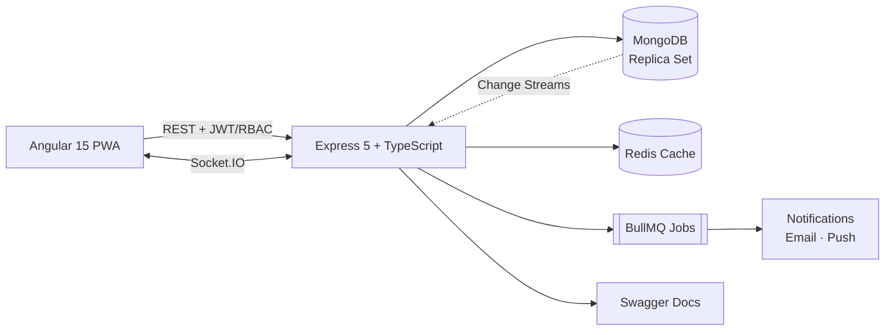

<!-- ═══════════════════════════ HEADER ═══════════════════════════ -->
<div align="center">


<a href="https://git.io/typing-svg">
  
</a>

<br/>


<a href="https://www.linkedin.com/in/pawangtm2419/"></a>
<a href="https://pkgtm2419.github.io/Pawan-Gautam-Portfolio/"></a>
<a href="https://youtube.com/@adhooragyaan"></a>
<a href="https://instagram.com/pkgtm2419"></a>

<br/><br/>

> *"Code like an engineer, think like a user, and dream like an artist."* 🚀

</div>

---

## 🙋‍♂️ About Me

<table>
<tr>
<td width="62%" valign="top">

- 💻 **MEAN Stack Developer** @ **Presage Insights Pvt. Ltd.**
- 🏭 Building an **enterprise CMMS** (Computerized Maintenance Management System) used for asset, scheduler, alarm & work-order management
- 🔌 Experienced with **IoT devices**, multi-level security & real-time BIOS updates
- ⚡ Passionate about **real-time systems**, **performance optimization** and **production stability**
- 🧱 Believer in **modular, feature-based architecture** — no duplicate code, no technical debt
- 🤖 Exploring **local AI-assisted development** (Ollama + Qwen2.5-Coder + OpenCode CLI)
- 🎓 B.Tech in Computer Science — **AKTU (2013 – 2017)**
- 🌍 Based in **Noida, India** 🇮🇳

</td>
<td width="38%" align="center" valign="middle">

```text
┌──────────────────────────┐
│ const pawan = {          │
│   role: "MEAN Developer",│
│   focus: ["Real-time",   │
│           "Scalability", │
│           "Clean Code"], │
│   coffee: Infinity ☕    │
│ };                       │
└──────────────────────────┘
```

</td>
</tr>
</table>

---

## 🛠️ Tech Stack

<div align="center">

### Core (MEAN)


### Languages & Web


### Data, Cache & Cloud


### DevOps & Tooling


<br/>


</div>

<details>
<summary><b>📚 Full skill breakdown (click to expand)</b></summary>
<br/>

| Layer | What I work with |
|---|---|
| **Frontend** | Angular 15, TypeScript, HTML5, CSS3, PWA / offline recovery, role-based dashboards |
| **Backend** | Node.js, Express.js 5, TypeScript, REST standards, Swagger docs, Winston logging |
| **Database** | MongoDB, Mongoose (schemas, validation, population, query optimization), change streams, replica sets, multi-database architecture |
| **Real-time** | Socket.IO, WebSockets, MongoDB change streams |
| **Caching / Queues** | Redis, BullMQ |
| **Security** | JWT, RBAC, strict TS validation, layered authentication, security hardening |
| **Integrations** | Firebase Admin (push notifications), Nodemailer, Sharp (image processing) |
| **Testing & Quality** | Jest, Supertest, ESLint, Prettier, Husky |
| **CI/CD & Deployment** | GitHub Actions, AWS CodeDeploy, PM2, staging pipelines |
| **Mobile** | React Native + TypeScript |

</details>

---

## 🚀 Featured Work

### 🏭 Enterprise CMMS — *Presage Insights*

> A production-grade maintenance management platform focused on **scalability, reliability and performance**.

| | |
|---|---|
| **Stack** | Angular 15 · Express.js 5 + TypeScript · MongoDB · Redis · Socket.IO |
| **Features** | Asset management · Schedulers · Alarms · Notifications · Work orders & tasks · Role-based access |
| **Highlights** | Multi-database architecture · PWA offline recovery · Real-time sync via change streams & replica sets · Redis caching · CI/CD staging with AWS CodeDeploy + GitHub Actions + PM2 |



---

### 🔌 Smart Devices (IoT) Platform

- ⚡ Real-time **socket-based IoT device communication**
- 🔐 **BIOS transfer**, layered authentication and live device monitoring
- 🧩 Full-stack: **Angular + Express + MongoDB + WebSocket**

### 🎯 Role-Based UI Application

- 👥 UI that adapts to roles — **Admin → State → Zone → End User**
- 📊 Custom dashboards, filters and data visualizations per role

### 📱 HRMS Mobile App *(in progress)*

- React Native + TypeScript · Express + MongoDB backend
- Roles: **Admin, HR, Employee**
- Modules: Attendance · Employees · Leaves · Salary Slips · Payroll · Notifications · Profile
- JWT + RBAC, location & camera permissions, OneUI-inspired design
- Built through a **phased, agent-assisted implementation plan** (`AGENTS.md` → `IMPLEMENTATION_TASK.md` → plan section)

### 🎨 Portfolio *(live)*

- Pure **HTML, CSS & JS** with smooth animations, fully responsive, dev-style branding
- 🔗 [pkgtm2419.github.io/Pawan-Gautam-Portfolio](https://pkgtm2419.github.io/Pawan-Gautam-Portfolio/)

---

## 📌 Highlighted Repositories

<div align="center">

| 📁 Repository | 📝 What it is | 🧰 Built with |
|:---|:---|:---:|
| [**Pawan-Gautam-Portfolio**](https://github.com/pkgtm2419/Pawan-Gautam-Portfolio) | Animated, fully responsive personal portfolio (live) |    |
| [**Service-Worker**](https://github.com/pkgtm2419/Service-Worker) | Service worker experiments for caching and offline support |   |
| [**GoogleMapAPI**](https://github.com/pkgtm2419/GoogleMapAPI) | Google Maps API integration demo |   |
| [**Thahrav-Cafe**](https://github.com/pkgtm2419/Thahrav-Cafe) | Cafe website project |  |
| [**love**](https://github.com/pkgtm2419/love) | A fun, creative HTML project |  |

<sub>📦 37 public repositories in total — <a href="https://github.com/pkgtm2419?tab=repositories">browse them all</a></sub>

</div>

---

## 🧠 How I Engineer

```text
 feature/
 └── module/
     ├── route          →  clean, versioned REST endpoints
     ├── controller     →  thin request handling
     ├── service        →  business logic
     ├── repository     →  data access (Mongoose)
     ├── model · dto · validator
     └── constants · permissions · helpers · sockets · cron · swagger
```

| Principle | In practice |
|---|---|
| 🧱 **Modular architecture** | Self-contained feature modules + shared `common / config / bootstrap` |
| 🧼 **Clean & consistent** | Standard API responses, consistent naming, reusable utilities |
| 🔒 **Secure by default** | JWT, RBAC, strict validation, hardened endpoints |
| 🚀 **Production-ready** | Logging, monitoring, testing, CI/CD, PM2, performance tuning |
| 📴 **Resilient UX** | PWA & offline recovery |
| 🚫 **No tech debt** | Refactor early, avoid duplicate code and unstable releases |

---

## 🤖 AI-Assisted Development

I'm actively integrating AI into my workflow to boost productivity — without compromising code quality.

- 🖥️ Fully **local AI coding setup** on Windows 11 — **Ollama + OpenCode CLI + Qwen2.5-Coder**
- 📋 Structured agent workflows with strict rules and **phase-by-phase** execution
- 📄 Documented the impact in a **CMMS case study: AI Integration & Productivity Improvements**

---

## 🔭 Currently Exploring

- 🔧 Lightweight **always-on background services** for Windows & Linux (~50 MB RAM budget)
- 📱 **On-device mobile ad blocker** with local network analysis (no server)
- 📈 **Algo trading tooling** for F&O using broker APIs
- 🎙️ **Personal voice assistant** experiments with AI

---

## 📊 GitHub Analytics

<div align="center">

<!-- Generated by the "Profile Summary Cards" workflow into this repo, so these never depend on a third-party server -->


<br/>


</div>

---

## 🐍 Contribution Snake

<div align="center">

<picture>
  <source media="(prefers-color-scheme: dark)" srcset="https://raw.githubusercontent.com/pkgtm2419/pkgtm2419/output/github-snake-dark.svg" />
  <source media="(prefers-color-scheme: light)" srcset="https://raw.githubusercontent.com/pkgtm2419/pkgtm2419/output/github-snake.svg" />
  
</picture>

</div>

---

## 🤝 Let's Connect

<div align="center">

Open to **collaboration**, **freelance conversations** and **tech discussions** around MEAN stack, real-time systems and IoT.

<a href="https://www.linkedin.com/in/pawangtm2419/"></a>
<a href="https://pkgtm2419.github.io/Pawan-Gautam-Portfolio/"></a>
<a href="https://youtube.com/@adhooragyaan"></a>
<a href="https://instagram.com/pkgtm2419"></a>

<br/><br/>


</div>
